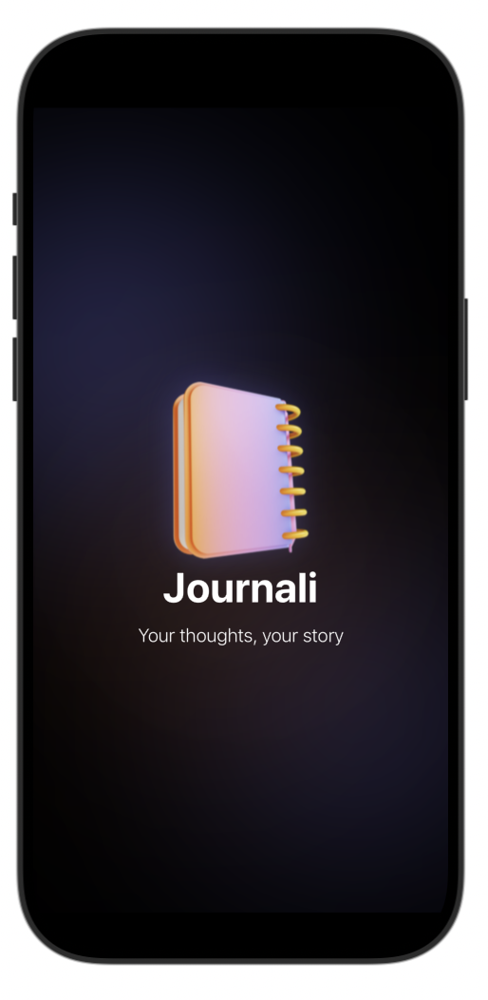
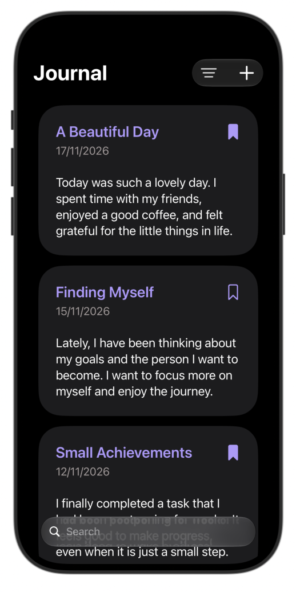
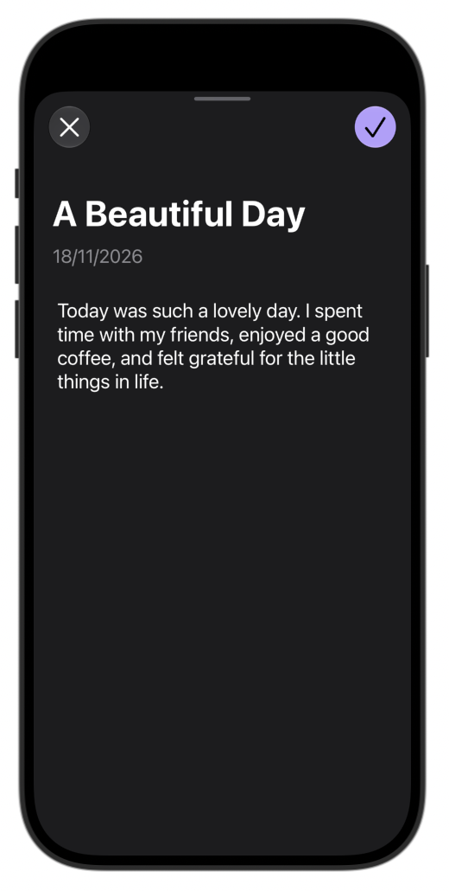
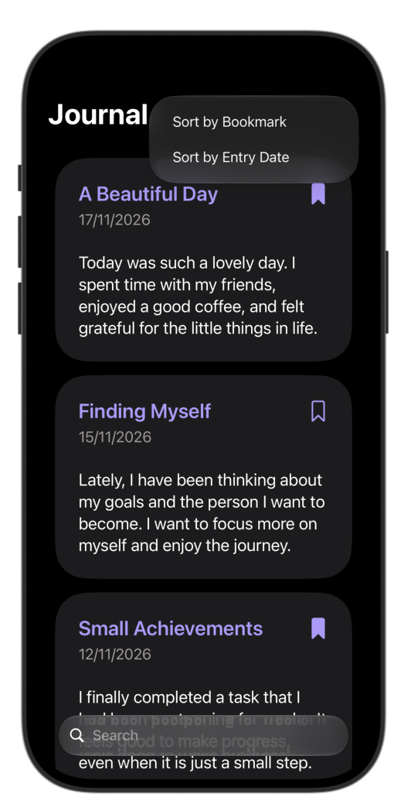

<div align="center">

# 📄 Journali

### Your thoughts, your story.

A simple, personal journaling app built with **SwiftUI**, designed to give users a calm space to write, edit, and organize their thoughts.


<br>


</div>

---

## ✨ About

Journali is a personal diary app where users can capture their thoughts, revisit meaningful moments, and keep their journal entries organized. Its dark interface, soft lavender accents, and simple layout aim to make writing feel comfortable and focused.

## ⚙️ Features

The current build allows users to:

| Feature | Description |
| --- | --- |
| ✍️ **Create Journal** | Write a journal entry with a title and content. |
| 📝 **Edit Journal** | Open an existing entry and update its title or content. |
| 🔎 **Search journals** | Find entries by searching their titles or content. Search is case-insensitive. |
| 🔖 **Bookmark Journals** | Mark entries to make them easier to find later. |
| ↕️ **Sort Journals** | Sort journals by bookmarks or entry date. |
| 🗑️ **Delete Journal** | Delete an entry with a confirmation alert. |
| 📖 **Empty state** | See a welcoming screen when there are no journal entries. |
| 💫 **Animated splash screen** | See the Journali logo and app introduction when launching the app. |

## 📸 Screenshots

<div align="center">

| Splash Screen | Journal Screen |
|:---:|:---:|
|  |  |

| Journal Editor | Sorting |
|:---:|:---:|
|  |  |

</div>

## 🛠️ Technologies

- **Swift** — programming language.
- **SwiftUI** — framework used to build the user interface.
- **MVVM** — architecture used to separate the data model, UI, and presentation logic.
- **Xcode** — development environment.

## 🧩 Project Structure

The project is organized using the Model–View–ViewModel (MVVM) pattern:

```text
Journali/
├── Model/
│   └── JournalEntry.swift
├── View/
│   ├── ContentView.swift
│   ├── JournalCard.swift
│   ├── JournalEditorView.swift
│   └── JournalView.swift
├── ViewModel/
│   └── JournalViewModel.swift
├── Theme.swift
└── MyApp.swift
```

| Folder / File | Responsibility |
| --- | --- |
| 📦 `Model` | Defines the journal entry data and related types. |
| 🖼️ `View` | Contains the app screens and reusable interface components. |
| 🧠 `ViewModel` | Manages journal entries and the actions performed on them. |
| 🎨 `Theme.swift` | Defines shared app colors and typography. |
| 🚀 `ContentView.swift` | Controls the splash screen and presents the main journal screen. |
| ⚙️ `MyApp.swift` | Provides the app's entry point. |

## 🚧 Current Limitations

- Journal entries are currently stored in memory and are **not persisted** between app launches. Entries may be lost when the app is terminated.
- The app is still under development, so features and the interface may evolve.

## 💡 Possible Future Improvements

- 💾 Persistent storage for journal entries.
- 🖼️ More customization options for the journal experience.
- 🌙 Additional appearance and personalization settings.
